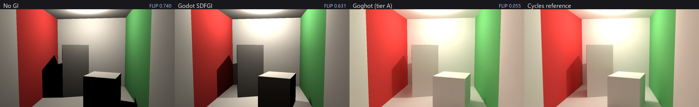
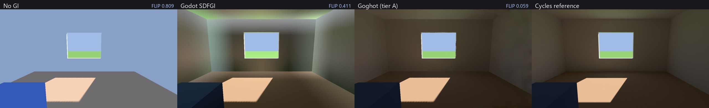
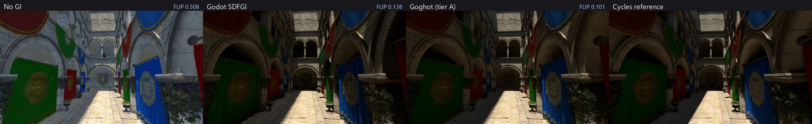
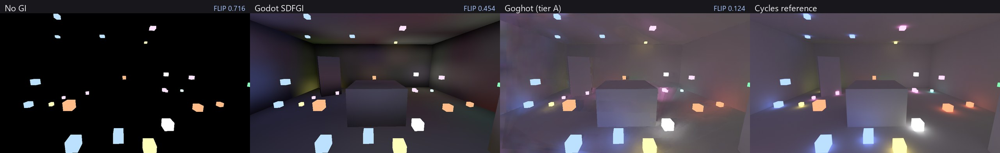
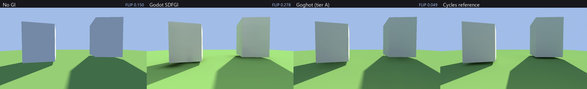
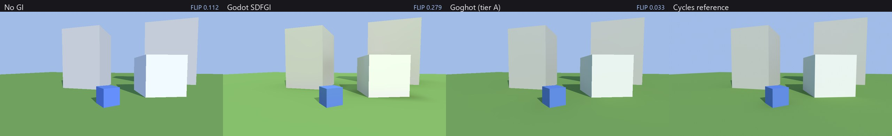
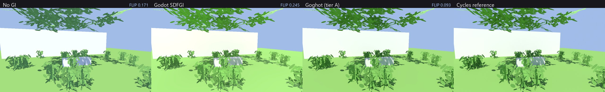
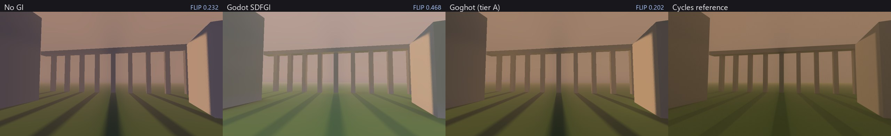

# Goghot

[中文](README.md) | **English**

**Goghot is a fork of Godot that aims for fully automatic real-time global illumination close to Unreal's Lumen.** No baking: place the sun, the sky and the lights, light in physical units, and interiors, exteriors and the transitions between them come out right, while the scene moves, objects are added or removed and lights are switched on and off. It is a general solution, not tuned for any particular game: one set of default parameters for every scene.

Based on Godot `master` (4.8-beta). The GI itself lives in a GDExtension ([`goghot/`](goghot/)); the engine only carries a few small, independent patches (see [Engine patches](#engine-patches)).

**About the name:** Goghot is **Godot** plus a pun on **Van Gogh**, whose paintings are known for their light and color, which is what this project is about: light bouncing and coloring a scene naturally.

**Why no pull requests to Godot:** the code of this project was written mostly with the help of AI (Claude), and Godot does not currently accept AI-generated contributions. Some of the engine patches are also specific to Goghot (for example the Goghot GI option in Environment) rather than general upstream features. So Goghot is maintained as a separate fork: rebased onto the latest upstream, with each engine patch kept as its own commit.

## Comparison

Each row, left to right: no GI, Godot's built-in SDFGI, Goghot (tier A, hardware ray tracing), Blender Cycles reference (1024 spp). Top right: [FLIP](https://github.com/NVlabs/flip) error against Cycles, lower is better. 960×540, one set of default parameters, no per-scene tuning.

**Closed Cornell box** (color bleeding; no sky light may leak in)


**Room with a single window** (light enters through the window and lights the room through multiple bounces)


**Sponza atrium** (Crytek Sponza, textured materials, sunlight from above)


**Many emissive objects** (no lights at all, only emissive materials)


**Walking out through a door** (the camera goes from inside to outside; this frame is outside)


**Outdoors, daytime**


**Dense foliage** (alpha-tested leaves; light passes through the gaps)


**Dusk with volumetric fog**


Mean FLIP over the 3 reference frames of each camera path (static start, moving, end), produced by [`goghot/testbench`](goghot/testbench/) on an RTX 5070:

| Scene | No GI | Godot SDFGI | **Goghot tier A** |
|---|---|---|---|
| cornell_box | 0.739 | 0.633 | **0.054** |
| indoor_window | 0.822 | 0.389 | **0.054** |
| sponza | 0.546 | 0.118 | **0.079** |
| emissive_many | 0.709 | 0.422 | **0.112** |
| door_transition | 0.402 | 0.328 | **0.053** |
| outdoor_day | 0.111 | 0.276 | **0.032** |
| foliage | 0.161 | 0.240 | **0.088** |
| dusk_fog | 0.231 | 0.466 | **0.201** |

Most of the dusk_fog error comes from a brightness difference between Godot's volumetric fog and Cycles: without GI the luminance ratio is already 1.21. The test bench has 17 scenes and can also run tier B (voxels) or compare against Godot's SSIL and VoxelGI (`--gi`).

## Usage

1. Build this fork's engine and the extension in [`goghot/`](goghot/) (see [Building](#building)).
2. Copy `goghot/testbench/addons/goghot/` into your project.
3. **Tick "Goghot GI" in the Environment** of your WorldEnvironment or camera. It sits next to SDFGI; quality is Low, Medium or High (default High).

That is all: no node, no Compositor setup. Views with Goghot GI enabled turn their SDFGI and VoxelGI off and Goghot takes over.

Alternatively, use the `GoghotGI` node for more control: tracer tier, debug views, histogram auto exposure and more. See [`goghot/README.md`](goghot/README.md).

Supported content: MeshInstance3D (static, alpha-tested, skinned, blend shapes), MultiMeshInstance3D, CSG, GridMap; BaseMaterial3D colors, textures, emission, alpha scissor and blending (glass); DirectionalLight3D, OmniLight3D, SpotLight3D, AreaLight3D; Panorama and Procedural skies; physical light units.

## Architecture

A unified final gather with interchangeable world tracers:

- **Screen-space probes**: one per 16×16 pixels, plus adaptive probes where depth or normals change sharply. Each probe traces 32 importance-sampled octahedral rays, followed by temporal and spatial filtering.
- **Trace order**: screen trace (HZB, previous frame color) → world tracer → sky (L2 SH).
- **World tracer** tiers:
  - **Tier A**: hardware ray tracing (Vulkan, BLAS/TLAS). Any-hit for alpha-tested foliage; skinned meshes get BLASes over Godot's skinned vertex buffers.
  - **Tier B**: voxels (clipmap + DDA) for GPUs without ray tracing.
  - **Tier C**: screen space only.
- **World-space radiance cache**: spatial hash (after SHaRC), camera-centered clipmap. It handles multiple bounces, off-screen emission and distant denoising; volumetric fog samples it directly.
- **Reflections**: rough surfaces reuse the probes; glossy ones use SSR with a world tracer fallback.
- **Exposure**: optional histogram auto exposure (trimmed high / low percentiles, center weighted).
- **Scene data** comes straight from the engine (patch 5): only changed instances are updated, and the TLAS is built from a packed buffer without creating any objects per frame.

## Engine patches

Each one is its own commit (prefix `[engine]`) so the fork rebases cleanly:

1. **External indirect light**: a Compositor effect can provide the indirect light that replaces Forward+'s ambient term; StandardMaterial3D works unchanged. Such an effect replaces SDFGI and VoxelGI.
2. **GPU vertex buffers of skinned meshes** exposed to the extension for BLAS builds (only buffers the skinning has written).
3. **Volumetric fog** can sample an external GI cache.
4. **Vulkan ray tracing fix**: TLAS instances reference a BLAS through the acceleration structure's own device address.
5. **Scene instance feed** (`RenderingServer.scenario_goghot_feed_poll`) and packed TLAS builds (`RenderingDevice.tlas_build_packed`).
6. **Built-in auto exposure fix**: NaN, Inf and negative pixels count as black, and a broken exposure history recovers. Before, a single NaN pixel turned the whole frame black or made it flash white.
7. **Goghot GI option in Environment**: the extension registers a global GI effect that runs for every view whose environment enables it.

## Test bench

[`goghot/testbench/`](goghot/testbench/) has 17 scenes: Cornell box, interiors, outdoor day, dusk with fog, door transition, dense foliage, many emissive objects, glass, reflections, a crowd of skinned characters, a day / night cycle, a dynamic scene, a large town, Sponza, area lights and more.

- Every scene has a fixed camera path; frames are rendered from the command line and compared against Blender Cycles renders of the same scene.
- Metrics: FLIP, SSIM, luminance ratio, frame-to-frame flicker on static frames, ghosting during motion, GPU time.
- Reports are written to the local `goghot/reports/` (not under version control).

```
python goghot/testbench/tools/run.py --godot <godot editor binary> --gi node --tag mytest
```

The comparison images are made from reports with `goghot/testbench/tools/readme_compare.py`.

## Performance

All numbers on an RTX 5070:

- **Test bench, 1080p, tier A**: whole-frame difference between GI on and off is 0.6–2.1 ms (Sponza 2.1 ms).
- **A real mid-size project** (~12k nodes, 4M triangles, 66 skinned characters, level streaming):
  - Goghot GI: 79–88 fps.
  - Godot's built-in SDFGI: 94–103 fps.
  - Scene collection on the main thread ~0.9 ms; the GI render callback ~0.5 ms.

RTX 3060-class GPUs, GPUs without ray tracing (tier B), AMD and Intel are **not tested yet**.

## Known limitations

- **Response time**: for the first frame or two after an object appears or a light turns on, the indirect light lags behind (ghosting ~0.075 in the dynamic scene).
- **Tier B** is darker and blurrier, at 2–3× the cost of tier A.
- **Not supported**: ShaderMaterial hit materials (needs a surface cache), custom sky shaders, refraction.
- **Also**: Forward+ only, single view (no VR multiview).
- More in [`goghot/KNOWN_ISSUES.md`](goghot/KNOWN_ISSUES.md).

## Building

On Windows:

```
pip install scons
scons platform=windows target=editor
cd goghot && scons target=template_debug
```

The extension's `goghot/api/extension_api.json` is dumped from this fork's engine (`godot --headless --dump-extension-api`), so the extension has to be used with this fork's engine.

## Donations

I have a full-time job and work on this project in my spare time. It doesn't need money, and the time I can spend maintaining it is limited, so there are no promises about how fast issues get answered or what is supported.

If you want to help, **please donate to [Godot](https://fund.godotengine.org/)**. And if you would like Godot to have better real-time global illumination, say so in the community ([Godot Proposals](https://github.com/godotengine/godot-proposals), the forum, the contributors chat) and convince the developers to bring better GI into the engine itself. That helps far more people than any fork.

## Credits

- **[Godot Engine](https://godotengine.org)**: this project is a fork of Godot, released under the [MIT license](LICENSE.txt).
  - Godot was originally developed by [Juan Linietsky](https://github.com/reduz) and [Ariel Manzur](https://github.com/punto-), open sourced in 2014, and is maintained by the Godot community and the [Godot Foundation](https://godot.foundation/).
  - Contributors: [AUTHORS.md](AUTHORS.md); third-party licenses: [COPYRIGHT.txt](COPYRIGHT.txt).
- **Methods we built on**:
  - [HDDAGI](https://github.com/godotengine/godot/pull/119869): voxel / HDDA tracing for tier B.
  - NVIDIA SHaRC: spatial hash radiance cache.
  - Unreal Engine's Lumen: the overall final gather architecture.
- **Testing and evaluation**:
  - [Blender Cycles](https://www.blender.org/): reference renders.
  - [NVIDIA FLIP](https://github.com/NVlabs/flip): error metric.
  - Crytek Sponza ([glTF version](https://github.com/KhronosGroup/glTF-Sample-Assets), CRYENGINE Limited License; not redistributed here, fetched with `fetch_assets.py`).
