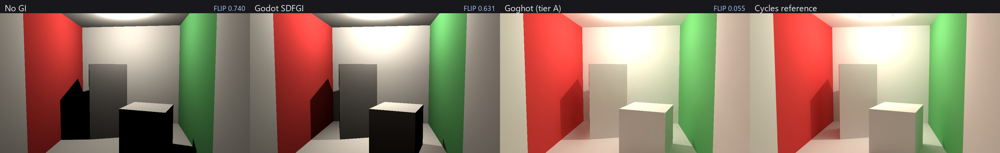
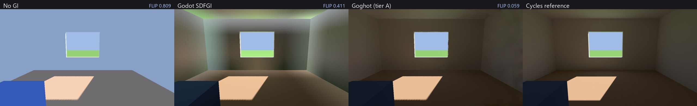
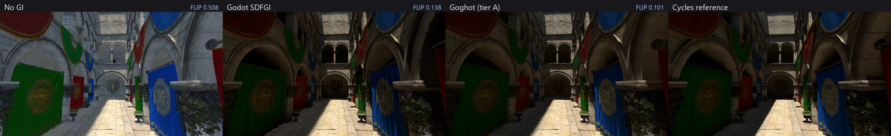
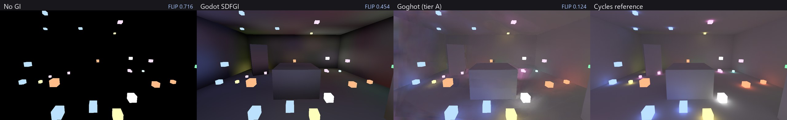
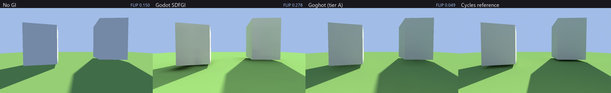
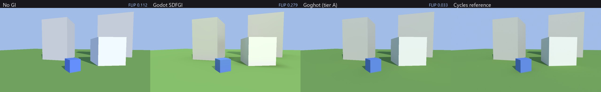
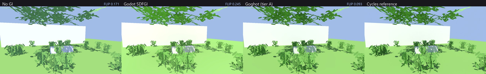
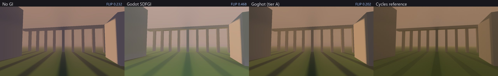

# Goghot

**Goghot 是 Godot 的一個分支，目標是做出接近 Unreal Lumen 的全自動即時全域光照（GI）。** 不烘焙：擺好太陽、天空和燈光，按物理單位打光，室內、室外、室內外過渡都正確，場景可以隨時移動、增刪物件、開關燈。這是通用方案，不針對特定遊戲調整，所有場景共用同一套預設參數。

基於 Godot `master`（4.8-beta）。GI 主體都在 GDExtension（[`goghot/`](goghot/)）裡；引擎只改了少量、各自獨立的補丁（見[引擎補丁](#引擎補丁)）。

**名字的由來：** Goghot 是 **Godot** 加上 **梵谷（Van Gogh）** 的諧音。梵谷的畫以光和色彩著稱，而這個專案要做的，正是讓光在場景裡自然地反彈、上色。

**為什麼不向 Godot 官方提交 PR：** 本專案的程式碼主要是在 AI（Claude）協助下寫成的，而 Godot 官方目前不接受 AI 生成的程式碼貢獻。另外，部分引擎補丁是專門為 Goghot 設計的（例如 Environment 裡的 Goghot GI 選項），不是通用的上游功能。所以 Goghot 以獨立分支的形式維護：持續 rebase 到最新的上游，每個引擎補丁各自是獨立的 commit。

## 對比

每組由左到右：不開 GI、Godot 內建 SDFGI、Goghot（A 檔，硬體光追）、Blender Cycles 參考圖（1024 spp）。右上角是和 Cycles 的 [FLIP](https://github.com/NVlabs/flip) 誤差，越低越好。960×540，同一套預設參數，沒有逐場景調參。

**封閉的 Cornell Box**（色彩滲透，不能有天光漏進來）


**室內，只有一扇窗**（光從窗戶進來，靠多次反彈照亮整個房間）


**Sponza 中庭**（Crytek Sponza，貼圖材質，陽光從上方進來）


**大量自發光物件**（場景裡沒有任何燈，只有自發光材質）


**推門走出室外**（相機從室內走到室外，這是走到室外後的一幀）


**室外白天**


**茂密植被**（alpha 測試的葉片，光線可以穿過葉片之間的縫隙）


**黃昏 + 體積霧**


相機路徑上 3 個參考幀（起點靜止、移動中、終點）的平均 FLIP（[`goghot/testbench`](goghot/testbench/) 產生，RTX 5070）：

| 場景 | 不開 GI | Godot SDFGI | **Goghot A 檔** |
|---|---|---|---|
| cornell_box | 0.739 | 0.633 | **0.054** |
| indoor_window | 0.822 | 0.389 | **0.054** |
| sponza | 0.546 | 0.118 | **0.079** |
| emissive_many | 0.709 | 0.422 | **0.112** |
| door_transition | 0.402 | 0.328 | **0.053** |
| outdoor_day | 0.111 | 0.276 | **0.032** |
| foliage | 0.161 | 0.240 | **0.088** |
| dusk_fog | 0.231 | 0.466 | **0.201** |

dusk_fog 的誤差主要來自 Godot 體積霧本身和 Cycles 的亮度差異：不開 GI 時亮度比就已經是 1.21。測試台共有 17 個場景，也可以跑 B 檔（體素），或和 Godot 的 SSIL、VoxelGI 比較（`--gi` 參數）。

## 使用方式

1. 編譯本分支的引擎，以及 [`goghot/`](goghot/) 裡的擴充（見[編譯](#編譯)）。
2. 把 `goghot/testbench/addons/goghot/` 複製到你的專案。
3. 在 **WorldEnvironment 或相機的 Environment 勾選「Goghot GI」**。這個選項和 SDFGI 並列，畫質可以選低、中、高（預設高）。

這樣就完成了，不需要加節點或設定 Compositor。勾選後，該 view 的 SDFGI 和 VoxelGI 會自動停用，由 Goghot 接手。

也可以改用 `GoghotGI` 節點，可以調整更多參數：追蹤器檔位、除錯視圖、直方圖自動曝光等等。詳見 [`goghot/README.md`](goghot/README.md)。

支援的內容：MeshInstance3D（靜態、alpha 測試、蒙皮、blend shape）、MultiMeshInstance3D、CSG、GridMap；BaseMaterial3D 的顏色、貼圖、自發光、alpha scissor 和混合（玻璃）；DirectionalLight3D、OmniLight3D、SpotLight3D、AreaLight3D；Panorama 和 Procedural 天空；物理燈光單位。

## 架構

統一的 Final Gather，加上可以替換的世界追蹤器：

- **螢幕空間探針**：每 16×16 像素一個，在深度或法線突變的地方自適應補點。每個探針發 32 條八面體方向的光線，做重要性採樣，再經過時間和空間濾波。
- **追蹤順序**：先做螢幕追蹤（HZB，使用上一幀的顏色）→ 再交給世界追蹤器 → 都沒打到就用天空（L2 SH）。
- **世界追蹤器**有三個檔位：
  - **A 檔**：硬體光追（Vulkan，BLAS/TLAS）。alpha 植被用 any-hit，蒙皮物件用 Godot 的蒙皮緩衝建 BLAS。
  - **B 檔**：沒有光追的顯卡改用體素（clipmap + DDA）。
  - **C 檔**：只做螢幕空間。
- **世界空間輻射快取**：空間雜湊（SHaRC 的思路），以相機為中心的 clipmap。負責多次反彈、畫面外的自發光和遠距離降噪；體積霧也直接採樣它。
- **反射**：粗糙表面重用探針的結果；光滑表面先做 SSR，失敗再交給世界追蹤器。
- **曝光**：直方圖自動曝光（剔除最高和最低的百分位、中心加權），可選用。
- **場景資料**直接從引擎讀取（補丁 5），只有變動的實例才更新；TLAS 從打包好的緩衝建構，每幀不建立任何物件。

## 引擎補丁

每一項都是獨立的 commit（前綴 `[engine]`），方便 rebase 上游：

1. **外部間接光注入**：Compositor 效果可以提供間接光，取代 Forward+ 的 ambient 項，StandardMaterial3D 不用改就能用。提供間接光的效果會取代 SDFGI 和 VoxelGI。
2. **蒙皮結果的 GPU 頂點緩衝**：暴露給擴充建 BLAS 用，只交出已經被蒙皮寫入過的緩衝。
3. **體積霧**可以採樣外部的 GI 快取。
4. **修 Vulkan 光追 bug**：TLAS 實例引用 BLAS 時，改用加速結構本身的 device address。
5. **場景實例資料直通**（`RenderingServer.scenario_goghot_feed_poll`），以及打包版的 TLAS 建構（`RenderingDevice.tlas_build_packed`）。
6. **內建自動曝光修正**：NaN、Inf、負值像素當成黑色計算，損壞的曝光歷史會自動恢復。原本只要一個 NaN 像素，整個畫面就會黑屏或白閃。
7. **Environment 的 Goghot GI 選項**：擴充註冊全域的 GI 效果，勾選了的 view 自動套用。

## 測試台

[`goghot/testbench/`](goghot/testbench/) 有 17 個場景：Cornell Box、室內、室外白天、黃昏加霧、推門過渡、茂密植被、大量自發光、玻璃、反射、蒙皮角色群、晝夜循環、動態場景、大型城鎮、Sponza、面光源等等。

- 每個場景都有固定的相機路徑，用命令列渲染出幀序列，和同一場景的 Blender Cycles 參考圖比對。
- 指標包括：FLIP、SSIM、亮度比、靜止畫面相鄰幀的閃爍、運動時的拖影、GPU 時間。
- 報告寫到本機的 `goghot/reports/`（不納入版本控制）。

```
python goghot/testbench/tools/run.py --godot <godot editor binary> --gi node --tag mytest
```

對比圖用 `goghot/testbench/tools/readme_compare.py` 從報告產生。

## 效能

所有數字都在 RTX 5070 上測得：

- **testbench，1080p，A 檔**：整幀開 GI 和關 GI 的差值是 0.6–2.1 ms（Sponza 2.1 ms）。
- **實際的中型專案**（約 1.2 萬個節點、400 萬個三角形、66 個蒙皮角色、關卡串流）：
  - 開 Goghot GI：79–88 FPS。
  - 用 Godot 內建 SDFGI：94–103 FPS。
  - 主執行緒收集場景約 0.9 ms，GI 的 render 回呼約 0.5 ms。

RTX 3060 級的顯卡、沒有光追的顯卡（B 檔）、AMD 和 Intel 都**還沒測過**。

## 已知限制

- **反應速度**：物體出現或開燈後的頭一兩幀，間接光還沒跟上（dynamic 場景的 ghost 約 0.075）。
- **B 檔**偏暗、偏模糊，成本是 A 檔的 2–3 倍。
- **不支援**：ShaderMaterial 的命中點材質（要做 surface cache 才能解決）、自訂天空 shader、折射。
- **其他限制**：只支援 Forward+ 和單一視角（不支援 VR 多視角）。
- 更多細節見 [`goghot/KNOWN_ISSUES.md`](goghot/KNOWN_ISSUES.md) 和各階段的報告。

## 編譯

在 Windows 上：

```
pip install scons
scons platform=windows target=editor
cd goghot && scons target=template_debug
```

擴充用的 `goghot/api/extension_api.json` 是從本分支的引擎匯出的（`godot --headless --dump-extension-api`），所以擴充要搭配本分支的引擎使用。

## 致謝

- **[Godot Engine](https://godotengine.org)**：本專案是 Godot 的分支，以 [MIT 授權](LICENSE.txt) 釋出。
  - Godot 最初由 [Juan Linietsky](https://github.com/reduz) 和 [Ariel Manzur](https://github.com/punto-) 開發，2014 年開源，之後由 Godot 社群和 [Godot Foundation](https://godot.foundation/) 維護。
  - 貢獻者名單見 [AUTHORS.md](AUTHORS.md)，第三方元件的授權見 [COPYRIGHT.txt](COPYRIGHT.txt)。
- **方法上的參考**：
  - [HDDAGI](https://github.com/godotengine/godot/pull/119869)：B 檔的體素 / HDDA 追蹤。
  - NVIDIA SHaRC：空間雜湊輻射快取。
  - Unreal Engine 的 Lumen：Final Gather 的整體架構。
- **測試和評估工具**：
  - [Blender Cycles](https://www.blender.org/)：參考圖。
  - [NVIDIA FLIP](https://github.com/NVlabs/flip)：誤差指標。
  - Crytek Sponza（[glTF 版本](https://github.com/KhronosGroup/glTF-Sample-Assets)，CRYENGINE Limited License；不隨本倉庫散佈，用 `fetch_assets.py` 下載）。
